# AURORA: Retail Competitor Intelligence (Agentic Reference Implementation)

[](https://www.python.org/)
[](https://fastapi.tiangolo.com)
[](LICENSE)
[](docs/CAPABILITY_MATRIX.md)

**Project page:** <https://sadiqgpasha89.github.io/Retail-Comp-Intel-Agentic-Solution/>

AURORA resolves which competitor products correspond to a retailer's own products, computes promotion-adjusted comparable prices, detects changes, and turns them into **recommendations that a human reviews and approves**. Rules and arithmetic are deterministic code; ML ranks candidates and spots anomalies; LLM agents are used only for bounded investigation and explanation.

> **Read this first.** This is a reference implementation running on **synthetic demo data** with a **simulated** agent/LLM layer. It does not scrape or contact competitors, it does not change prices anywhere, and it has no real authentication. It is not production-ready. [`docs/CAPABILITY_MATRIX.md`](docs/CAPABILITY_MATRIX.md) lists every feature as implemented, partial, simulated or missing, with code and test references.



---

## What it does today

| Area | Status |
|---|---|
| Four-tier resolution: rules → classical ML → agents → human review | Working end to end on demo data. Tier 2 uses a deterministic heuristic scorer, Tier 3 a simulated LLM |
| Governed recommendation lifecycle (propose, review, approve/reject, dry-run, measure) with policy gates and role checks | **Implemented and tested** |
| Hash-chained audit log; append-only observations and evidence; "as of" history | **Implemented and tested** |
| Source registry with a compliance gate (permission never assumed; never-permitted actions) | **Implemented and tested** for the import path |
| CSV/JSON listing import with reject/quarantine and retained evidence | **Implemented and tested** |
| Promotion-adjusted effective price (Decimal, itemised, conditions explicit) | Implemented as a tested library; not yet driving the live pipeline |
| Availability states (unknown ≠ out of stock), phantom-inventory hypothesis, price signals, assortment gaps | Implemented as tested libraries; not yet exposed in the UI/API |
| Eight explicit match classes with a hard-conflict guard | Implemented as a tested library; live pipeline still returns legacy verdicts |
| Live collection from real sources, scheduler, workers | **Missing** |
| Authentication, RBAC, tenant isolation | **Missing** (demo identity headers only) |
| Alerts, reports, natural-language assistant | **Missing** |
| GCP / AWS deployment | Terraform scaffolds, **never applied or validated** |

### Measured results (not claims)

| Check | Result |
|---|---|
| Unit tests (`tests/unit`, including 71 domain tests and 8 route-handler tests) | **101 passed** |
| Golden benchmark, live pipeline, 8 synthetic cases | **7 / 8 (87.5%)**. Miss: `ZEN-TV-65-OLED` (expected `DIRECT_SUBSTITUTE`, got `EQUIVALENT_PRIVATE_LABEL`) |
| HTTP integration, edge-case and performance suites | Updated but **not executed in the build environment** (no network, no real FastAPI install). Run `make test` with dependencies installed |

An earlier version of this repository reported 100% benchmark accuracy by scoring scripted answers, and displayed hard-coded latency and quality figures as live telemetry. Both were removed; metrics now report only what is measured.

---

## Architecture

### Four-tier decision flow



1. **Deterministic:** valid GTIN checksum matches (τ = 1.0), brand/category gates, honeypot quarantine.
2. **Classical ML:** bi-encoder retrieval and cross-encoder scoring. τ ≥ 0.92 auto-commits, 0.65 to 0.92 goes to agents, below 0.40 means no equivalent. The thresholds are universal defaults, not calibrated per category.
3. **Agentic arbitration:** Supervisor, Matcher, Promo, Strategy and Reflection agents in a Plan, Execute, Reflect, Report loop within a step budget. Competitor-intent labels are hypotheses, not findings.
4. **Human review:** contradictory or low-confidence cases enter a review queue; decisions feed a concept-drift test.

### Governed layer



- **Approval is a decision record, not an action.** It runs policy checks (known cost, margin floor, price bounds, MAP when known, maximum change, currency, region, stock) on a context the server builds from the catalogue.
- **Execution is a dry run by default.** A real write needs `WRITES_ENABLED=true`, a configured integration and an approved recommendation. No integration ships, so `dry_run=false` is refused.
- **Financial impact is only estimated when the inputs exist** (volume, cost, elasticity bounds); otherwise the recommendation lists what is missing.

More diagrams (components, data workflow, agent sequence, class and ER models, compliance flow, deployment, trust boundaries): [`diagrams/`](diagrams/README.md).

---

## Quick start

```bash
git clone https://github.com/sadiqgpasha89/Retail-Comp-Intel-Agentic-Solution.git
cd Retail-Comp-Intel-Agentic-Solution
make install            # venv + editable install with dev extras
make run                # http://localhost:8000
```

Docker: `make docker-build && make docker-up`.

Copy `.env.example` to `.env` to change settings. Leave `GEMINI_API_KEY` blank to use the simulated provider.

### Try the governed workflow

```bash
curl -s localhost:8000/api/v1/recommendations | jq '.top_actions[0] | {workflow_id, action_type, recommended_price}'
ID=<workflow_id from above>
curl -X POST localhost:8000/api/v1/recommendations/$ID/review  -H 'X-Actor-Id: ana' -H 'X-Actor-Role: analyst'         -H 'Content-Type: application/json' -d '{}'
curl -X POST localhost:8000/api/v1/recommendations/$ID/approve -H 'X-Actor-Id: pat' -H 'X-Actor-Role: pricing_manager' -H 'Content-Type: application/json' -d '{}'
curl -X POST localhost:8000/api/v1/recommendations/$ID/execute -H 'X-Actor-Id: pat' -H 'Content-Type: application/json' -d '{"idempotency_key":"run-0001"}'   # dry run
curl -s localhost:8000/api/v1/audit/verify
```

`X-Actor-Id` / `X-Actor-Role` are a **demo identity for the audit trail, not authentication**. Keep the server on localhost or a trusted network.

### Tests and evaluation

```bash
make test               # everything (needs real dependencies)
make test-domain        # governed-layer tests, only pydantic required
make test-unit | make test-integration | make test-edge | make test-perf
make eval               # scores the live pipeline on the golden set and lists misses
```

---

## API overview

All routes are under `/api/v1`. Full table in [`docs/FSD.md`](docs/FSD.md#6-api-summary).

| Group | Routes |
|---|---|
| Intelligence | `POST /intelligence/analyze`, `GET /intelligence/stream` (SSE) |
| Recommendations | `GET /recommendations`, `GET /recommendations/workflow`, `POST /recommendations/{id}/review\|approve\|reject\|execute\|outcome`, `POST /recommendations/orchestrate` |
| Governance | `GET /audit`, `GET /audit/verify`, `GET/PUT /sources`, `POST /imports`, `GET /observations/history` |
| Review queue | `GET /hitl/queue`, `POST /hitl/decision` |
| Quality | `GET /metrics` (measured values only), `GET /drift`, `POST /pipelines/run-eval` |
| Demo data | `POST /pipelines/generate-dataset`, `/run-ingest`, `/run-full-lifecycle`; `GET /catalog/*`, `GET /graph/subgraph`, chaos routes |

**Breaking change in 1.2.0:** `POST /recommendations/approve` was removed. It returned success without checking anything or dispatching anywhere. Use the lifecycle routes.

---

## Documentation

| Document | Purpose |
|---|---|
| [`docs/CAPABILITY_MATRIX.md`](docs/CAPABILITY_MATRIX.md) | Plan requirement → code → tests → status, backlog, test evidence |
| [`docs/BRD.md`](docs/BRD.md) | Business requirements, scope, risks |
| [`docs/FSD.md`](docs/FSD.md) | Functional requirements, API, acceptance scenario status |
| [`docs/TSD.md`](docs/TSD.md) | Technical design, algorithms, configuration, security, deployment |
| [`docs/SADR.md`](docs/SADR.md) | Architecture decision records (replaces the old `ARCHITECTURE.md`) |
| [`docs/DATA_DICTIONARY.md`](docs/DATA_DICTIONARY.md) | Entities and fields, including the governed layer |
| [`docs/USER_GUIDE.md`](docs/USER_GUIDE.md) | Using the dashboard and the approval workflow |
| [`diagrams/`](diagrams/README.md) | Mermaid sources and rendered SVGs |

## Repository layout

```
src/retail_intel/   api, agents, datascience, data_engineering, hitl, llmops, mlops, metrics, domain (governed layer)
src/frontend/       dashboard (templates + static JS/CSS)
data/               synthetic fixtures and the golden benchmark
deploy/             gcp and aws terraform scaffolds (unvalidated)
docker/  configs/  scripts/  tests/  docs/  diagrams/
```

## Configuration highlights

| Variable | Default | Meaning |
|---|---|---|
| `OBSERVATION_DB_PATH` | `:memory:` | Set a file path to persist observations, recommendations and audit |
| `WRITES_ENABLED` | `false` | Downstream writes; also needs an integration (none ships) |
| `MIN_GROSS_MARGIN_PCT` / `MAX_PRICE_CHANGE_PCT` | 10 / 30 | Approval policy limits |
| `EXECUTION_MODE` | `open_stack` | `gcp` selects cloud provider code that is not exercised by tests |

## Known gaps and roadmap

The prioritised backlog (auth, persisted source registry, collection workers and a first real adapter, alerts, reports, trained matching models and a larger labelled benchmark, wiring the new match classes and pricing library into the live pipeline, deployment validation) is in [`docs/CAPABILITY_MATRIX.md`](docs/CAPABILITY_MATRIX.md#backlog-prioritised). Compliance boundary: the project must never bypass authentication, paywalls, CAPTCHAs or rate limits, and never place orders.

## License

Apache 2.0, see [LICENSE](LICENSE).
