# Diagrams

All diagrams are authored as [Mermaid](https://mermaid.js.org) sources in `src/` and rendered to SVG in `rendered/`. GitHub also renders `.mmd` files directly. Legacy raster diagrams from the original repository are kept in `legacy/`; they predate the current four-tier wording and the governed domain layer.

Re-render after editing a source:

```bash
npm install -g @mermaid-js/mermaid-cli   # once; provides mmdc
make diagrams                             # or: bash diagrams/render.sh
```

| # | Diagram | Type | Source | Rendered |
|---|---|---|---|---|
| 01 | System context: users, inputs, optional/unimplemented integrations | flowchart | [src](src/01-system-context.mmd) | [svg](rendered/01-system-context.svg) |
| 02 | Component architecture by package | flowchart | [src](src/02-architecture-components.mmd) | [svg](rendered/02-architecture-components.svg) |
| 03 | Four-tier decision flow | flowchart | [src](src/03-four-tier-decision-flow.mmd) | [svg](rendered/03-four-tier-decision-flow.svg) |
| 04 | End-to-end data workflow | flowchart | [src](src/04-e2e-data-workflow.mmd) | [svg](rendered/04-e2e-data-workflow.svg) |
| 05 | Agent plan, execute, reflect, report sequence | sequence | [src](src/05-agent-sequence.mmd) | [svg](rendered/05-agent-sequence.svg) |
| 06 | Governed domain model | class | [src](src/06-class-domain-model.mmd) | [svg](rendered/06-class-domain-model.svg) |
| 07 | Storage data model | ER | [src](src/07-er-data-model.mmd) | [svg](rendered/07-er-data-model.svg) |
| 08 | Recommendation lifecycle | state | [src](src/08-recommendation-state-machine.mmd) | [svg](rendered/08-recommendation-state-machine.svg) |
| 09 | Source compliance gate | flowchart | [src](src/09-source-compliance-flow.mmd) | [svg](rendered/09-source-compliance-flow.svg) |
| 10 | Deployment scaffolds (GCP, AWS, local) | flowchart | [src](src/10-deployment-gcp.mmd) | [svg](rendered/10-deployment-gcp.svg) |
| 11 | Security and trust boundaries | flowchart | [src](src/11-security-trust-boundaries.mmd) | [svg](rendered/11-security-trust-boundaries.svg) |

## Reading them honestly

Diagrams show the **designed** architecture and mark what is not built: dotted edges and labels such as "not implemented", "simulated" or "unvalidated" are deliberate. For the status of each capability see [../docs/CAPABILITY_MATRIX.md](../docs/CAPABILITY_MATRIX.md).

## Previews






