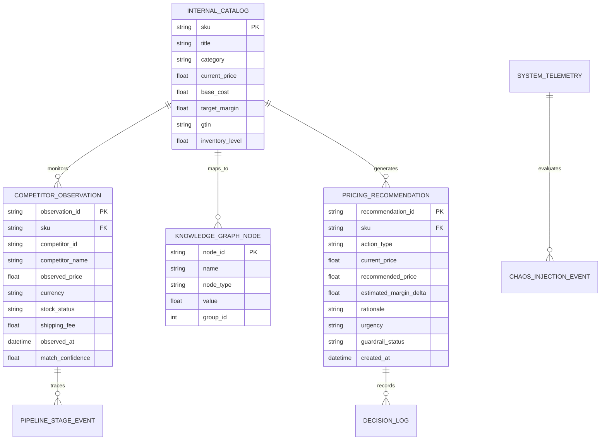

# Enterprise Data Dictionary & Schema Specification
## AURORA Retail Competitor Intelligence

**Document Version:** 3.0.0  
**Status:** Working draft. Not formally reviewed or approved.  
**Scope:** Ingestion, Storage, Vector Indexing, Graph Modeling, Decision Directives, and Telemetry

---

## Executive Summary & Data Topology

This document specifies the enterprise data models, field schemas, validation constraints, data types, and business semantics governing the **AURORA Retail Competitor Intelligence** platform. 

The bundled **demo** dataset can be generated at up to 20,000 synthetic data points across 48 fictional competitors and 10 categories (the checked-in fixtures hold 8 items). Nothing is scraped; data is synthetic. The platform models semi-structured catalogs, exact GTIN product registries, high-dimensional vector embeddings, bi-directional knowledge graphs, and tactical pricing recommendations.



---

## 1. Core Entity Catalogs

### 1.1 Internal Product Catalog (`internal_catalog`)
Represents the enterprise's authoritative internal master product inventory.

| Attribute Name | Physical Type | Logical Type | Nullable | Primary / Foreign Key | Validation Constraints / Enum | Business Description & Semantic Rule |
| :--- | :--- | :--- | :---: | :---: | :--- | :--- |
| `sku` | `VARCHAR(64)` | String | No | **PK** | Regex: `^[A-Z0-9\-]{4,20}$` | Enterprise Stock Keeping Unit unique identifier. |
| `title` | `VARCHAR(255)` | String | No | - | Min length: 3 chars | Full human-readable retail product title. |
| `category` | `VARCHAR(64)` | Enum | No | - | `Electronics`, `Grocery`, `Fashion`, `Home & Garden`, `Beauty`, `Health & Wellness`, `Automotive`, `Sports & Outdoors`, `Toys & Games`, `Pet Supplies` | Merchandise taxonomy classification level 1. |
| `current_price` | `DECIMAL(10,2)` | Float | No | - | `> 0.00` | Current active retail listing price in enterprise storefront. |
| `base_cost` | `DECIMAL(10,2)` | Float | No | - | `> 0.00` | Cost of Goods Sold (COGS) / wholesale acquisition cost. |
| `target_margin` | `DECIMAL(5,4)` | Float | No | - | `0.0500 <= x <= 0.8500` | Target gross margin threshold $((\text{Price} - \text{COGS}) / \text{Price})$. |
| `gtin` | `VARCHAR(14)` | String | Yes | - | GTIN-8, GTIN-12, GTIN-13, GTIN-14 checksum valid | Global Trade Item Number (UPC/EAN/ISBN) barcode standard. |
| `inventory_level` | `INTEGER` | Integer | No | - | `>= 0` | Available real-time sellable inventory count in fulfillment centers. |
| `elasticity_coefficient` | `DECIMAL(5,3)` | Float | No | - | `-5.000 <= x <= 0.000` | Historical own-price elasticity of demand ($\epsilon_d$). |
| `created_at` | `TIMESTAMP` | ISO-8601 | No | - | UTC Timestamp | Catalog record provisioning timestamp. |
| `updated_at` | `TIMESTAMP` | ISO-8601 | No | - | UTC Timestamp | Last catalog synchronization or price change event. |

#### JSON Schema Specification
```json
{
  "$schema": "http://json-schema.org/draft-07/schema#",
  "title": "InternalCatalogProduct",
  "type": "object",
  "properties": {
    "sku": { "type": "string", "pattern": "^[A-Z0-9\\-]{4,20}$" },
    "title": { "type": "string", "minLength": 3, "maxLength": 255 },
    "category": {
      "type": "string",
      "enum": [
        "Electronics", "Grocery", "Fashion", "Home & Garden", "Beauty",
        "Health & Wellness", "Automotive", "Sports & Outdoors", "Toys & Games", "Pet Supplies"
      ]
    },
    "current_price": { "type": "number", "minimum": 0.01 },
    "base_cost": { "type": "number", "minimum": 0.01 },
    "target_margin": { "type": "number", "minimum": 0.05, "maximum": 0.85 },
    "gtin": { "type": ["string", "null"], "pattern": "^[0-9]{8,14}$" },
    "inventory_level": { "type": "integer", "minimum": 0 }
  },
  "required": ["sku", "title", "category", "current_price", "base_cost", "target_margin", "inventory_level"]
}
```

---

### 1.2 Competitor Scraped Catalog & Observations (`competitor_observations`)
Stores individual competitor pricing and inventory telemetry scraped across monitored e-commerce websites.

| Attribute Name | Physical Type | Logical Type | Nullable | Primary / Foreign Key | Validation Constraints / Enum | Business Description & Semantic Rule |
| :--- | :--- | :--- | :---: | :---: | :--- | :--- |
| `observation_id` | `VARCHAR(64)` | UUIDv4 | No | **PK** | UUID Format | Globally unique identifier for every price check scraping event. |
| `sku` | `VARCHAR(64)` | String | No | **FK** | Must match `internal_catalog.sku` | Associated enterprise target SKU. |
| `competitor_id` | `VARCHAR(32)` | Enum | No | - | `AMZN_US`, `WMT_US`, `TGT_US`, `BBY_US`, `EBAY_US`, `HD_US`, `LOW_US`, `KRO_US`, `CST_US`, etc. (48 domains) | Normalized competitor merchant code identifier. |
| `competitor_name` | `VARCHAR(128)` | String | No | - | - | Trade name of the monitored merchant (e.g. "Amazon US", "Walmart Marketplace"). |
| `observed_price` | `DECIMAL(10,2)` | Float | No | - | `> 0.00` | Competitor's active displayed listing price. |
| `currency` | `VARCHAR(3)` | ISO-4217 | No | - | Default: `USD` | Standard ISO-4217 three-letter currency code. |
| `stock_status` | `VARCHAR(20)` | Enum | No | - | `IN_STOCK`, `OUT_OF_STOCK`, `LOW_STOCK`, `PREORDER` | Competitor inventory availability status. |
| `shipping_fee` | `DECIMAL(8,2)` | Float | No | - | `>= 0.00` | Minimum standard shipping surcharge (default: 0.00 for free shipping). |
| `match_method` | `VARCHAR(32)` | Enum | No | - | `EXACT_GTIN`, `HYBRID_VECTOR_BM25`, `LLM_AGENT_VERIFIED` | Product identity resolution tier used to pair this listing. |
| `match_confidence` | `DECIMAL(4,3)` | Float | No | - | `0.000 <= x <= 1.000` | Multi-modal matching score (must exceed 0.88 for auto-reprice). |
| `observed_at` | `TIMESTAMP` | ISO-8601 | No | - | UTC Timestamp | Precise real-time timestamp when HTML scraping occurred. |

---

## 2. Product Matching & Identity Resolution

### 2.1 Matching Thresholds & Hierarchy Table

```
========================================================================================
 TIER 1: EXACT GTIN BARCODE RESOLUTION (Confidence: 1.000)
    ↓ (Fallback if GTIN missing / marketplace bundle)
 TIER 2: HYBRID DENSE VECTOR + BM25 SPARSE MATCHING (Cosine >= 0.880, BM25 >= 14.50)
    ↓ (Fallback if ambiguity / Cross-Encoder Margin < 0.150)
 TIER 3: MULTI-AGENT LLM SPECIFICATION ARBITRATION (Agent P-E-R-R Consensus)
    ↓ (Fallback if confidence < 0.880)
 TIER 4: HUMAN-IN-THE-LOOP (HITL) MERCHANDISING REVIEW QUEUE
========================================================================================
```

| Match Level Code | Name | Minimum Score Threshold | Maximum False-Positive Rate (FPR) | Latency SLA | Escalation Target |
| :--- | :--- | :--- | :--- | :--- | :--- |
| `T1_GTIN` | Deterministic GTIN Match | $1.000$ (Exact Barcode Match) | $< 0.0001\%$ | $< 1\text{ ms}$ | Auto-promoted to Decision Tier |
| `T2_VECTOR` | Dense Vector (Gemini Embedding) | $\text{Cosine Similarity} \ge 0.880$ | $< 0.05\%$ | $< 15\text{ ms}$ | Auto-promoted to Decision Tier |
| `T2_BM25` | Sparse BM25 Keyword Search | $\text{Score} \ge 14.500$ | $< 0.12\%$ | $< 8\text{ ms}$ | Auto-promoted to Decision Tier |
| `T3_LLM` | Multi-Agent LLM Consensus | Dual Agreeing LLM Decisions | $< 0.01\%$ | $< 1.8\text{ s}$ | Logged with rationale & confidence |
| `T4_HITL` | Merchandiser Review Queue | Indeterminate / Score $< 0.880$ | $0.00\%$ (Human Verified) | $< 4\text{ hours}$ | Sent to Merchandiser Queue |

---

## 3. Decision Directives & Recommendation Engine

### 3.1 Pricing Recommendations (`pricing_recommendations`)

| Attribute Name | Physical Type | Logical Type | Nullable | Validation Constraints / Enum | Business Description & Semantic Meaning |
| :--- | :--- | :--- | :---: | :--- | :--- |
| `recommendation_id` | `VARCHAR(64)` | UUIDv4 | No | UUID format | Globally unique recommendation event key. |
| `sku` | `VARCHAR(64)` | String | No | Foreign Key to `internal_catalog.sku` | Target enterprise product identifier. |
| `category` | `VARCHAR(64)` | String | No | Standard Category Enum | Merchandise category classification. |
| `action_type` | `VARCHAR(20)` | Enum | No | `PRICE_DROP`, `PRICE_INCREASE`, `HOLD_PRICE`, `PROMOTE_BUNDLE`, `CLEARANCE` | Tactical commercial pricing directive. |
| `current_price` | `DECIMAL(10,2)` | Float | No | `> 0.00` | Baseline active listing price before intervention. |
| `recommended_price` | `DECIMAL(10,2)` | Float | No | `> base_cost * (1 + target_margin_min)` | Calculated optimal price post-guardrail enforcement. |
| `estimated_margin_delta`| `DECIMAL(6,4)` | Float | No | Percentage (e.g. `+0.0420` = +4.2%) | Projected gross margin impact relative to baseline. |
| `urgency` | `VARCHAR(16)` | Enum | No | `CRITICAL`, `HIGH`, `MEDIUM`, `LOW` | Operational response urgency. |
| `guardrail_status` | `VARCHAR(16)` | Enum | No | `PASSED`, `TRIGGERED_FLOOR`, `TRIGGERED_CEILING`, `TRIGGERED_VELOCITY` | Result of safety guardrail evaluation. |
| `rationale` | `TEXT` | String | No | Min length: 20 chars | Human-readable commercial explanation with competitive context. |
| `created_at` | `TIMESTAMP` | ISO-8601 | No | UTC Timestamp | Recommendation computation time. |

#### Tactical Action Types & Business Rules

```
┌─────────────────────────┬─────────────────────────────────────────────────────────────┬────────────────────────────────────┐
│ Action Type             │ Trigger Condition                                           │ Primary Business Objective         │
├─────────────────────────┼─────────────────────────────────────────────────────────────┼────────────────────────────────────┤
│ PRICE_DROP              │ Low-price competitor undercut > 4.5% & Stock = IN_STOCK     │ Defend buy-box & market share      │
│ PRICE_INCREASE          │ Key competitors OUT_OF_STOCK & Inventory > 50 units         │ Capture scarcity margin premium    │
│ HOLD_PRICE              │ Competitor price change within noise band (+/- 1.5%)         │ Avoid margin-eroding price wars    │
│ PROMOTE_BUNDLE          │ Competitor offering bundle discount on adjacent accessories │ Preserve basket AOV                │
│ CLEARANCE               │ Inventory aging > 90 days & Velocity < 0.2 units/day        │ Free trapped working capital       │
└─────────────────────────┴─────────────────────────────────────────────────────────────┴────────────────────────────────────┘
```

---

## 4. Retail Knowledge Graph Entities & Relations

### 4.1 Graph Nodes (`kg_nodes`)

| Node Type | `node_id` Prefix | Attributes & Metadata | Visual Representation (3D Space) |
| :--- | :--- | :--- | :--- |
| `PRODUCT` | `prod_<sku>` | `sku`, `title`, `price`, `margin`, `inventory` | Large Neon Sphere (Color-coded by Category) |
| `BRAND` | `brand_<name>` | `brand_name`, `tier` (`Premium`, `Value`, `Direct`) | Medium Geometric Octahedron |
| `CATEGORY` | `cat_<name>` | `category_name`, `department` | Large Central Cluster Hub Sphere |
| `COMPETITOR` | `comp_<id>` | `competitor_name`, `aggression_index`, `market_share` | High-vis Red / Amber Satellite Sphere |
| `GTIN` | `gtin_<code>` | `barcode`, `registry_authority` (`GS1`) | Small High-density Cyan Node |

### 4.2 Graph Edges & Relations (`kg_links`)

| Relation Type | Source Node | Target Node | Weight / Strength | Semantic Meaning |
| :--- | :--- | :--- | :--- | :--- |
| `BELONGS_TO` | `PRODUCT` | `CATEGORY` | $1.00$ | Catalog taxonomy parentage. |
| `MANUFACTURED_BY` | `PRODUCT` | `BRAND` | $0.95$ | Brand ownership and manufacturing origin. |
| `IDENTIFIED_BY` | `PRODUCT` | `GTIN` | $1.00$ | Exact international barcode identity. |
| `COMPETES_WITH` | `PRODUCT` | `COMPETITOR` | $0.50 \dots 1.00$ (Match Conf) | Active competitive overlap monitored across market. |
| `CROSS_PRICE_ELASTIC`| `PRODUCT` | `PRODUCT` | $-1.00 \dots +1.00$ | Cross-price elasticity coefficient ($\epsilon_{ij}$). |

---

## 5. System Observability & Telemetry Plane

### 5.1 Telemetry Metrics Specification

| Metric Identifier | Measurement Unit | Sampling Rate | Healthy Baseline Range | Critical Alert Threshold |
| :--- | :--- | :--- | :--- | :--- |
| `system.pipeline.total_datapoints` | Integer Count | Real-time / Event | $20,000 \dots 25,000$ | $< 18,000$ |
| `system.pipeline.execution_time_ms`| Milliseconds | Per Execution | $45 \dots 90\text{ ms}$ | $> 500\text{ ms}$ |
| `system.drift.wasserstein_distance`| Float Index | Hourly Rollup | $0.010 \dots 0.065$ | $> 0.150$ |
| `system.drift.psi` (Pop. Stability)| Float Index | Hourly Rollup | $0.000 \dots 0.080$ | $> 0.200$ |
| `system.api.p99_latency_ms` | Milliseconds | 1-minute window | $8 \dots 35\text{ ms}$ | $> 120\text{ ms}$ |
| `system.api.http_5xx_rate` | Percentage | Continuous | $0.000\%$ | $> 0.050\%$ |
| `system.agent.consensus_score` | Float $[0, 1]$ | Per Agent Invocation | $0.920 \dots 0.990$ | $< 0.850$ |

### 5.2 Chaos Injection Fault Payloads

| Fault Type Code | Target Subsystem | Injected Fault Parameter | Expected Resiliency Response |
| :--- | :--- | :--- | :--- |
| `SCRAPER_BLOCK_403` | Ingestion Scraper | Simulate Akamai/Cloudflare IP Ban (HTTP 403) | Auto-switch to Residential Proxy pool; retry with exponential backoff |
| `PRICE_TELEMETRY_SPIKE` | Decision Engine | Synthetic outlier price ($0.01 or $99,999.00) | Hard guardrail rejection; alert triggered; price freeze |
| `VECTOR_DB_TIMEOUT` | Matching Service | 5000ms latency on Qdrant vector similarity | Circuit breaker trips; graceful fallback to deterministic GTIN index |
| `MODEL_DRIFT_BURST` | MLOps Drift Monitor | Population Stability Index $\text{PSI} \ge 0.35$ | Immediate Page-Hinkley alarm; auto-trigger embedding retune |

---

## 6. Golden Evaluation Benchmarks & Truth Sets

### 6.1 Benchmark Validation Dataset Schema (`golden_eval_dataset`)

| Field Name | Type | Description |
| :--- | :--- | :--- |
| `test_case_id` | `VARCHAR(32)` | Unique test scenario identifier (e.g. `EVAL_MATCH_084`). |
| `raw_title_a` | `TEXT` | Storefront product title with marketing text and abbreviations. |
| `raw_title_b` | `TEXT` | Competitor product title with alternative formatting. |
| `ground_truth_match` | `BOOLEAN` | Human-curated ground truth (`TRUE` = same physical product). |
| `ground_truth_category`| `VARCHAR(64)` | Verified ground truth category. |
| `ground_truth_gtin` | `VARCHAR(14)` | Verified GS1 registered GTIN barcode. |
| `pass_threshold_cosine`| `FLOAT` | Expected minimum cosine similarity under Gemini Embeddings. |

---

## 7. Governed Domain Layer (retail_intel.domain)

Authoritative for observations, evidence, recommendations and audit. SQLite physical schema is in `domain/store.py`; types below are the Pydantic models.

### 7.1 `observation` (append-only)

| Column / field | Type | Notes |
| :--- | :--- | :--- |
| `observation_id` | text PK | `obs_<kind3>_<sha256[:20]>` of kind, source, listing, region, payload hash and values; identical input yields the same id |
| `kind` | enum | `price`, `availability`, `promotion` |
| `tenant_id`, `source_id`, `competitor_id` | text | Provenance scope |
| `listing_id` | text | Competitor SKU / listing key |
| `region` | text | Default `GLOBAL` |
| `currency` | text, nullable | ISO code; null for availability |
| `observed_at` | UTC timestamp | When the page/feed says it was true |
| `retrieved_at` | UTC timestamp | When we obtained it; used for `as_of` queries |
| `payload_hash` | text | SHA-256 of the raw payload; links to `evidence.content_hash` |
| `is_demo` | int | 1 when collection method is `DEMO_DATA` |
| `quarantined` | int | 1 when flagged suspicious; excluded from queries by default |
| `body` | JSON | Full `Observation` including `values`, `provenance`, `quality_flags` |

`values` by kind:

| Kind | Keys |
| :--- | :--- |
| `price` | `list_price`, `sale_price`, `reference_price`, `shipping_fee`, `unit_price`, `unit_measure`, `pack_size`, `title`, `brand`, `category`, `gtin`, `url` (decimals as strings) |
| `availability` | `state` (`IN_STOCK`, `LOW_STOCK`, `OUT_OF_STOCK`, `PREORDER`, `BACKORDER`, `UNKNOWN`), delivery-day window, raw status |
| `promotion` | `offers`: list of offers (type, discount kind and value, conditions, validity window, code) |

`Provenance`: `tenant_id`, `source_id`, `competitor_id`, `collection_method` (e.g. `MANUAL_UPLOAD`, `DEMO_DATA`), `source_url`, `retrieved_at`, `parser_version`, `payload_hash`, `evidence_uri`, `run_id`.

`QualityFlag`: `DEMO_DATA`, `SUSPICIOUS_CONTENT`, `QUARANTINED`, `UNVERIFIED_GTIN` (and others defined in `observations.py`).

### 7.2 `evidence` (append-only, content-addressed)

| Column | Type | Notes |
| :--- | :--- | :--- |
| `content_hash` | text PK | SHA-256 of the bytes; referenced as `evidence://sha256/<hash>` |
| `media_type` | text | e.g. `text/csv`, `application/json` |
| `content` | blob | Raw payload as received |
| `stored_at` | UTC timestamp | |

### 7.3 `recommendation`

| Field | Type | Notes |
| :--- | :--- | :--- |
| `recommendation_id` | text PK | `rec_` + 16 hex of SHA-256(action type, internal SKU, competitor SKU); stable across regenerations |
| `tenant_id` | text | |
| `rec_type` | enum | `MONITOR`, `INVESTIGATE`, `HOLD_PRICE`, `REVIEW_PRICE`, `PROTECT_MARGIN`, `EVALUATE_PROMOTION`, `SOURCE_EQUIVALENT`, `ESCALATE_COMPLIANCE` |
| `status` | enum | `PROPOSED`, `REVIEWED`, `APPROVED`, `REJECTED`, `ACTIONED`, `MEASURED`, `EXPIRED` |
| `internal_sku`, `competitor_listing_id` | text | |
| `currency`, `region` | text | Demo data is labelled USD by assumption |
| `current_price`, `proposed_price` | decimal | `proposed_price` is null for non-price actions |
| `rationale`, `assumptions[]`, `evidence_ids[]` | text / list | Assumptions are mandatory content, not optional commentary |
| `estimate` | object, nullable | `horizon`, `margin_delta_low/expected/high`, `assumptions` |
| `estimate_gap` | object, nullable | `missing[]`: inputs required for an estimate that were not available |
| `owner`, `created_at`, `expires_at` | | Default expiry 7 days from registration |
| `decisions[]` | list | `actor`, `action`, `at`, `notes` |
| `executions` | map | idempotency key to result |
| `outcome` | object, nullable | Measured result recorded at `MEASURED` |

### 7.4 `audit_event` (append-only, hash-chained)

| Column / field | Notes |
| :--- | :--- |
| `seq` | Autoincrement order |
| `event_id` (unique), `ts`, `actor`, `action`, `entity_type`, `entity_id`, `details` | What happened, who claimed to do it, to what |
| `prev_hash`, `hash` | `hash = sha256(canonical_json(all other fields incl. prev_hash))`; first event links to 64 zeros |

Typical actions: `propose`, `review`, `approve`, `approval_denied`, `approval_blocked`, `reject`, `dry_run`, `write_refused`, `execute`, `measure`, `expire`, `import`, `import_refused`, `source_upsert`.

### 7.5 `CompetitorSource` and `SourcePolicy` (in-memory)

| Field | Notes |
| :--- | :--- |
| `source_id`, `competitor_id`, `merchant`, `domain`, `marketplace_seller` | Identity |
| `country`, `region`, `currency`, `channel`, `categories[]` | Scope |
| `source_type` | `OFFICIAL_API`, `PARTNER_FEED`, `LICENSED_PROVIDER`, `PUBLIC_WEB`, `MANUAL_UPLOAD`, `DEMO` |
| `priority` (1 highest to 5), `schedule_cron`, `freshness_sla_hours` | Schedule is stored, not executed |
| `policy.permitted` (default **false**), `basis`, `reviewed_by`, `reviewed_at`, `revoked_at`, `rate_limit_per_minute`, `allowed_actions[]` | Use is refused unless permitted with a basis |

### 7.6 Import file columns

Required: `competitor_sku`, `title`, `price`, `currency`. Optional: `list_price`, `shipping_fee`, `pack_size`, `delivery_days`, `availability`, `observed_at` (ISO-8601, UTC assumed if naive), `gtin`, `brand`, `category`, `region`, `url`, `description`, `offers` (JSON).

### 7.7 Match model

`MatchClass`: `EXACT_MATCH`, `EQUIVALENT_VARIANT`, `DIRECT_SUBSTITUTE`, `PRIVATE_LABEL_EQUIVALENT`, `COMPLEMENTARY_PRODUCT`, `RELATED_PRODUCT`, `NO_MATCH`, `NEEDS_REVIEW`. `HardConflict`: `field` (brand, model, pack_size, size, capacity, generation, bundle), `ours`, `theirs`, `reason`. `MatchDecision` carries evidence, tier, feature scores, confidence, model version, timestamp and reviewer overrides (model defined; not yet persisted by the pipeline).

### 7.8 Entity relationships



---

## Document Status

This dictionary has not been through a formal review; no approvals are recorded. Sections 1 to 6 describe the original demo data model and **may differ from the running code in places** (for example, the live recommendation engine uses the action types in the FSD and capability matrix, not every enum listed above). Section 7 describes the governed domain layer, which is the authoritative model for new work and is verified by tests.
