# Functional Specification Document (FSD)

**Product:** AURORA, retail competitor intelligence
**Traces to:** [BRD](BRD.md) (BR-xx). **Implementation status:** [CAPABILITY_MATRIX.md](CAPABILITY_MATRIX.md). Each functional requirement below carries a status tag: **[built]**, **[partial]**, **[demo]** (simulated/synthetic) or **[planned]**.

Diagrams: [diagrams/README.md](../diagrams/README.md).

---

## 1. System overview

AURORA ingests competitor listings, resolves which of them correspond to the retailer's own products, computes comparable effective prices, detects changes, and produces recommendations that move through a human approval workflow. Decisions are made by deterministic code first; ML ranks and detects; LLM agents are used only for bounded investigation and explanation.

## 2. Actors and permissions

| Actor | Role string (request header) | May review | May approve | May reject |
|---|---|---|---|---|
| Viewer / unidentified | `viewer` (default) | no | no | no |
| Analyst | `analyst` | yes | no | yes |
| Pricing manager | `pricing_manager` | yes | yes | yes |
| Category manager | `category_manager` | yes | yes | yes |
| Administrator | `admin` | yes | yes | yes |

> The role is read from `X-Actor-Role` and the actor from `X-Actor-Id`. **This identifies a claimed actor for the audit trail; it is not authentication.** Real SSO/RBAC is planned (B-01).

## 3. Functional requirements

### 3.1 Sources and ingestion

| ID | Requirement | BR | Status |
|---|---|---|---|
| FR-01 | Register/update a source with type, region, currency, priority, SLA and policy (`PUT /api/v1/sources/{id}`); list all or only compliance-passing sources (`GET /api/v1/sources?active_only=`) | 01, 02 | [built]; in-memory |
| FR-02 | A source is usable only if `policy.permitted` is true with a non-empty `basis`, not revoked, and the action is in `allowed_actions`. Demo sources are exempt | 02 | [built] |
| FR-03 | Never permit: bypass authentication/paywall, solve CAPTCHA, evade rate limits, place order, complete checkout, create account, make payment | 03 | [built] |
| FR-04 | Import a CSV/JSON listing file for a registered source (`POST /api/v1/imports?source_id=&fmt=`). Required columns are validated; malformed rows are rejected with a reason and never repaired; rows with injection-like text are stored but quarantined; invalid GTIN checksums are flagged | 04, 05, 24 | [built] |
| FR-05 | The raw upload is retained as content-addressed evidence and referenced from every observation's provenance; re-importing identical content stores nothing new | 04 | [built] |
| FR-06 | Scheduled and on-demand collection runs with status, retries, backoff, pagination, incremental refresh | 01 | [planned] (B-03) |
| FR-07 | At least one real adapter for an official API or partner feed | 02 | [planned] (B-04) |
| FR-08 | Token-bucket rate limiting, bounded retry with backoff, per-source health and freshness SLA | 02, 26 | [built] as a library; not yet driven by a collector |

### 3.2 Observations and history

| ID | Requirement | BR | Status |
|---|---|---|---|
| FR-09 | Observations are immutable and append-only (database triggers block UPDATE/DELETE); IDs are deterministic so duplicates collapse | 04, 12 | [built] |
| FR-10 | History query returns observations for a listing by kind (price, availability, promotion), optionally filtered by competitor/region, and `as_of` a time (what was retrieved at or before it). Quarantined rows are excluded by default (`GET /api/v1/observations/history`) | 12 | [built] |
| FR-11 | Observations from demo data carry a `DEMO_DATA` flag | 05 | [built] |
| FR-12 | Source values are preserved alongside normalised values | 04 | [built] |

### 3.3 Matching

| ID | Requirement | BR | Status |
|---|---|---|---|
| FR-13 | Tier 1: valid GTIN match resolves with confidence 1.0; honeypot signatures are quarantined | 07 | [built] |
| FR-14 | Tier 2: candidate retrieval and pair score; ≥0.92 auto-commit, 0.65–0.92 escalate, <0.40 no equivalent | 07 | [demo] heuristic scorer, universal thresholds |
| FR-15 | Tier 3: agents (matcher, promo, strategy, reflection) investigate within a step budget, return a structured verdict with a reasoning summary | 07 | [demo] simulated LLM |
| FR-16 | Tier 4: contradictory or low-confidence cases enter a human review queue; decisions feed the Page-Hinkley concept-drift test (`/api/v1/hitl/*`) | 07 | [built]; in-memory, no reviewer identity |
| FR-17 | Eight match classes exist as a typed model, with a hard-conflict guard that downgrades any attempted auto-match across a pack-size, model, capacity, generation or bundle difference | 08, 09 | [built] as a library; the live pipeline still returns legacy verdicts (B-09) |
| FR-18 | A match decision records evidence, method/tier, feature scores, confidence, model version, timestamp and reviewer override history | 08 | [partial] model defined, not persisted |
| FR-19 | Live accuracy on the golden set is measurable (`POST /api/v1/pipelines/run-eval`, `make eval`) using the real pipeline, with misses listed | 25 | [built]: 7/8 |

### 3.4 Price, promotion, availability

| ID | Requirement | BR | Status |
|---|---|---|---|
| FR-20 | `compute_effective_price` returns list price, effective price and an itemised breakdown (each offer: applied or not, saving, reason, conditions) using Decimal arithmetic | 10 | [built] library |
| FR-21 | Offer types: coupon code, clipped coupon, cart discount, multi-buy, bundle, threshold, loyalty, payment offer, limited-time. Conditions are of three kinds: *shopper* conditions (membership, new customer, app-only, payment instrument, geography, personalised) are never assumed and apply only when the caller states them; *basket* conditions (quantity/spend threshold) are evaluated against the basket; *access steps* (code, clip) are applied but always shown. Ineligible offers are listed with the reason | 11 | [built] |
| FR-22 | Tax and shipping treatment is explicit; unit price normalised via the unit library; cross-currency requires supplied FX rates and errors otherwise | 10 | [built] |
| FR-23 | Availability is classified as in-stock, low-stock, out-of-stock, preorder, backorder or **unknown** (with the delivery-promise window recorded alongside); unknown is never reported as out-of-stock | 13 | [built] library |
| FR-24 | Phantom inventory is only raised as a hypothesis after repeated corroborating samples | 13 | [built] library |
| FR-25 | A discount below list price sets `requires_map_review`; it is never an accusation | 14 | [built] |
| FR-26 | Wire effective price, availability and signals into the analysis path and UI | 10, 13, 15 | [planned] (B-16) |

### 3.5 Signals and strategy

| ID | Requirement | BR | Status |
|---|---|---|---|
| FR-27 | Price-change detection (percentage threshold), robust outlier test (median/MAD), volatility, discount depth, promotion frequency, price gap and index | 15 | [built] library |
| FR-28 | New/delisted listings, assortment gaps, category coverage, observed share of assortment (only when a defensible denominator is supplied) | 06 | [built] library |
| FR-29 | Hypotheses about price moves list alternatives and a confidence; wording never asserts intent | 16 | [built] for `hypothesize_price_move`; [partial] for legacy agent labels |
| FR-30 | Financial estimate is a low/expected/high weekly margin range computed only when current price, proposed price, unit cost, weekly volume and elasticity bounds are all supplied; otherwise an `InsufficientInputs` result lists what is missing | 17 | [built] |
| FR-31 | Legacy dollar figures from the demo strategy agent use assumed volumes and are labelled illustrative | 17 | [built] (labelling) |

### 3.6 Recommendations and decisions

| ID | Requirement | BR | Status |
|---|---|---|---|
| FR-32 | `GET /api/v1/recommendations` returns engine output and idempotently registers each action as a governed recommendation with a stable `workflow_id` (hash of action type, internal SKU, competitor SKU), status `PROPOSED`, 7-day expiry, listed assumptions, and either an estimate or an `estimate_gap` | 18 | [built] |
| FR-33 | `POST /{id}/review` requires analyst or above; `PROPOSED → REVIEWED` | 18 | [built] |
| FR-34 | `POST /{id}/approve` requires pricing manager, category manager or admin; only from `REVIEWED`; runs the policy engine and refuses on any blocking violation (HTTP 422 `POLICY_BLOCKED` with the violations). Approval records a decision; it changes no price anywhere | 18, 19, 20 | [built] |
| FR-35 | Policy checks: currency match, allowed region, no promotion with zero stock, **cost known**, margin floor (default 10% of price), price floor/ceiling, MAP, maximum single change (default 30%) | 19 | [built] |
| FR-36 | `POST /{id}/reject` requires a reason; from `PROPOSED` or `REVIEWED` | 18 | [built] |
| FR-37 | `POST /{id}/execute` is dry-run by default and idempotent per key. A real write requires `WRITES_ENABLED=true`, a configured integration and an approved recommendation; otherwise HTTP 409 | 20 | [built]; no integration ships |
| FR-38 | `POST /{id}/outcome` records a measured result from `ACTIONED` to `MEASURED` | 18 | [built] |
| FR-39 | Expired recommendations cannot be advanced | 18 | [built] |
| FR-40 | All transitions, denials and blocks are written to the hash-chained audit log (`GET /api/v1/audit`, `GET /api/v1/audit/verify`) | 18 | [built] |
| FR-41 | Alerts, routing, deduplication, cooldown, acknowledgement; scheduled reports and CSV/XLSX/PDF export | 22 | [planned] (B-07, B-13) |
| FR-42 | Natural-language assistant with citations and permission scoping | 21 | [planned] (B-11) |

### 3.7 Quality, metrics, drift

| ID | Requirement | BR | Status |
|---|---|---|---|
| FR-43 | `GET /api/v1/metrics` returns five planes containing only values measured in-process (counters, observed latency percentiles, live PSI); unmeasured fields are omitted, not zero-filled | 25, 26 | [built] |
| FR-44 | `GET /api/v1/drift` reports PSI against a reference baseline, Wasserstein distance **only when embeddings are supplied** (otherwise `null`, status `NOT_MEASURED`), and a Page-Hinkley statistic | 26 | [built]; baseline is demo data |
| FR-45 | LLM groundedness is a token-overlap screening signal; precision/recall are not computed | 25 | [partial] |
| FR-46 | Per-category precision/recall/F1 and false-positive rate | 25 | [planned] (B-10) |

### 3.8 Security behaviours

| ID | Requirement | BR | Status |
|---|---|---|---|
| FR-47 | Untrusted text is scanned for instruction-like content, truncated, and wrapped as data when shown to an LLM | 24 | [partial] scanner applied on import (quarantine); not yet applied in the agent path (B-18) |
| FR-48 | Role-based access control, tenant isolation, SSO/OIDC | 23 | [planned] (B-01) |
| FR-49 | Secrets in a secrets manager; redaction of secrets and confidential cost data in logs and LLM context | 23 | [planned] |

## 4. Resolution flow

## 5. Data workflow

## 6. API summary

All routes are under `/api/v1`. Responses are JSON. Errors use standard HTTP status codes with a `detail` field.

| Area | Method and path | Notes |
|---|---|---|
| Health | `GET /health` | catalogue sizes |
| Catalogue | `GET /catalog/internal`, `GET /catalog/competitor` | bundled demo data |
| Intelligence | `POST /intelligence/analyze` | four-tier resolution for one competitor SKU |
| | `GET /intelligence/stream` | SSE reasoning stream |
| Recommendations | `GET /recommendations`, `GET /recommendations/summary`, `POST /recommendations/orchestrate` | engine output; orchestrate runs the agents for one SKU |
| | `GET /recommendations/workflow`, `GET /recommendations/workflow/{id}` | governed items, filter by `status` |
| | `POST /recommendations/{id}/review`, `/approve`, `/reject`, `/execute`, `/outcome` | lifecycle; actor headers |
| Governance | `GET /audit`, `GET /audit/verify` | hash-chained events |
| | `GET /sources`, `PUT /sources/{id}` | registry |
| | `POST /imports?source_id=&fmt=csv\|json` | raw body, max 5 MB |
| | `GET /observations/history` | `kind`, `listing_id`, `as_of` |
| HITL | `GET /hitl/queue`, `POST /hitl/decision`, `POST /hitl/resolve/{task_id}` | 404 on unknown task |
| Quality | `GET /metrics`, `GET /drift`, `POST /pipelines/run-eval` | `run-eval` scores the live pipeline |
| Pipelines | `POST /pipelines/generate-dataset`, `/load-realworld`, `/run-ingest`, `/run-full-lifecycle` | demo data generation/loading |
| Graph | `GET /graph/subgraph` | knowledge graph |
| Chaos | `GET /chaos/status`, `POST /chaos/inject`, `/chaos/reset` | resilience simulation |

**Breaking change:** `POST /recommendations/approve` (which returned `APPROVED_AND_QUEUED` without checking anything) has been removed. Use the lifecycle endpoints above.

## 7. Non-functional behaviours

| Area | Behaviour |
|---|---|
| Idempotency | Re-importing identical content, re-registering a recommendation and replaying an execute key are all no-ops |
| Determinism | Money uses `Decimal`; no floating-point comparison of prices in the domain layer |
| Time | Naive datetimes are rejected by the store; all stored times are UTC |
| Limits | Import body ≤ 5 MB; per-field text truncated before LLM use |
| Observability | Correlation ID header on every response; metrics as above |
| Performance | No production-scale throughput is claimed. Test bounds on demo data are loose |

## 8. Configuration

See [.env.example](../.env.example). Governance settings: `TENANT_ID`, `OBSERVATION_DB_PATH` (`:memory:` by default; set a path to persist observations, recommendations and the audit log), `WRITES_ENABLED` (false), `MIN_GROSS_MARGIN_PCT` (10), `MAX_PRICE_CHANGE_PCT` (30).

## 9. Acceptance scenario status

The plan's twelve end-to-end scenarios, assessed against what runs today.

| # | Scenario | Status | Notes |
|---|---|---|---|
| 1 | Import products, configure a source, collect and retain a timestamped listing with evidence | **partial** | Source registration and upload import with retained evidence work; "collect" from a live source does not exist; the internal master is bundled, not imported |
| 2 | Detect a price change with before/after, source, time and comparable unit price | **partial** | `detect_price_changes` and history work on imported data; no API or UI for the comparison |
| 3 | Match exact GTIN deterministically and explain | **met** | `APX-AURA-99` → `INT-EL-001`, tier 1, reason returned |
| 4 | Route a similar but different pack/model to review instead of false-matching | **partial** | The guard and tests exist and the HITL queue works; the live pipeline does not yet route through the guard (B-09) |
| 5 | Extract a conditional offer and compute effective price with conditions visible | **partial** | Calculation and breakdown are built and tested; extraction from pages is not (importer takes structured offers) |
| 6 | Availability change with unknown, unavailable and delivery-window changes distinct | **partial** | Library and tests; no API/UI |
| 7 | Category insight grounded in multiple observations with coverage | **partial** | `category_coverage`, gaps exist; no insight generator |
| 8 | Pricing recommendation using COGS, assumptions, floors enforced | **met** for the floor and assumptions; **partial** overall | Margin floor, MAP and bounds block approval; ranges need volume and elasticity that the demo lacks, so an explicit gap is shown |
| 9 | Approval before any downstream write, with audit | **met** (by refusal) | Writes are disabled; approval, dry-run and audit are recorded; no real write path exists to test |
| 10 | Prompt-injection resistance, quarantine, rate limiting, LLM outage handling | **partial** | Injection scan and quarantine work on import; the rate limiter is tested as a library; agents are not yet protected; LLM outage handling is not tested against a real provider |
| 11 | Golden benchmark with per-category quality, promotion accuracy, hallucination rate, cost | **partial** | Overall accuracy is live (7/8); per-category quality, promotion accuracy and cost are not measured |
| 12 | Clean-environment deploy with health, logs, metrics, backup, restore | **not met** | Not performed; deploy scaffolds are unvalidated |
