# Technical Specification Document (TSD)

**Product:** AURORA, retail competitor intelligence
**Audience:** engineers building, running and extending the system.
**Companions:** [FSD](FSD.md) (what), [SADR](SADR.md) (why), [CAPABILITY_MATRIX](CAPABILITY_MATRIX.md) (status), [DATA_DICTIONARY](DATA_DICTIONARY.md) (fields), [diagrams](../diagrams/README.md).

---

## 1. Technology stack

| Layer | Choice | Notes |
|---|---|---|
| Language | Python ≥ 3.10 (Docker image uses 3.12) | `pyproject.toml` |
| API | FastAPI, Uvicorn | Versioned routes under `/api/v1`; SSE for agent streaming |
| Models / validation | Pydantic v2, pydantic-settings | Typed domain objects and settings |
| Numerics | `decimal.Decimal` (money), NumPy, SciPy, scikit-learn | Isolation Forest, Wasserstein, PSI |
| Graph | NetworkX | In-process |
| Storage | SQLite (stdlib `sqlite3`) | Observations, evidence, recommendations, audit |
| Logging | structlog | Correlation ID middleware |
| Frontend | Jinja template, vanilla JS, Three.js | `src/frontend` |
| Optional | `hnswlib` (ANN), Google Cloud client libraries (`gcp` extra) | Not required to run |
| Packaging | setuptools, `src/` layout, package `retail_intel` | Version 1.2.0 |

Dependencies are lower-bounded, not pinned or locked (B-15).

## 2. Repository layout

```
src/retail_intel/
  api/              FastAPI app, DI (get_app_state), middleware, routes/
  core/             settings (config.py), logging
  data_engineering/ normalization, ingestion simulation, feature store, stream broker, dataset generator
  datascience/      tier1_rules, tier2_ml (bi/cross encoder, anomaly), recommendation_engine (legacy)
  agents/           supervisor, matcher, promo, strategy, reflection, tools/, graph/
  hitl/             human review queue
  llmops/           golden_eval, guardrails, prompts
  mlops/            drift_radar, registry, validation
  metrics/          five-plane metrics engine (measured values only)
  domain/           governed layer: units, match_classes, pricing, availability,
                    observations, signals, sources, safety, store, audit, recommendations
src/frontend/       templates + static assets
data/               synthetic fixtures + golden benchmark set
configs/            category_weights.yaml (currently not loaded by code, B-14)
deploy/{gcp,aws}/   terraform + scripts (unvalidated)
docker/             Dockerfile, docker-compose.yml
diagrams/           src/*.mmd, rendered/*.svg, legacy/*.png, render.sh
docs/               BRD, FSD, TSD, SADR, CAPABILITY_MATRIX, DATA_DICTIONARY, USER_GUIDE, GitHub Pages site
tests/              unit (incl. unit/domain), integration, edge_case, performance
scripts/            run_golden_eval.py
```

## 3. Runtime architecture



### 3.1 Application state

`ApplicationState` (in `api/main.py`) is created in the FastAPI lifespan and stored on `app.state.app_state`; routes reach it through `get_app_state(request)`. It holds the catalogues, the resolution services, the metrics engine and the governed layer:

| Attribute | Type | Purpose |
|---|---|---|
| `observations` | `ObservationStore` | SQLite store (path from `OBSERVATION_DB_PATH`, default `:memory:`) |
| `audit_log` | `AuditLog(sink=observations)` | Hash-chained events persisted in the same database |
| `source_registry` | `SourceRegistry` | In-memory source configuration |
| `workflow` | `RecommendationWorkflow` | Lifecycle + `PolicyEngine` configured from settings; `integration=None` |

State is per process. With `--workers > 1` each worker has its own in-memory registry, queue, graph and counters, and an in-memory SQLite database is not shared. Use a file path for the store and treat multi-worker operation as unsupported until B-02/B-05.

### 3.2 Request paths

- **Analysis:** `/intelligence/analyze` normalises the competitor payload, runs Tier 1; if unresolved, Tier 2 retrieval and scoring; between thresholds, Tier 3 agents; contradictory or low-confidence results are queued for review. Each completed analysis is recorded in the metrics engine with its duration.
- **Recommendations:** the legacy `RecommendationEngine` produces `MerchandisingAction`s; the API registers each as a governed `Recommendation` and returns it with a `workflow_id`. Lifecycle calls go through `RecommendationWorkflow`.
- **Import:** `POST /imports` checks the compliance gate, stores the raw body as evidence, parses rows, appends observations, writes an audit event.

## 4. Domain layer design

The domain layer has no dependency on FastAPI or on the ML/agent code; it needs only Pydantic and the standard library. It can be tested alone (`make test-domain`).

### 4.1 Money and units
- All prices are `Decimal`; results are quantised with `money()` (2 dp, half-up) only at the edge.
- `units.py` converts to a base unit per dimension (mass, volume, length, count). `same_quantity` compares with a tolerance; `per_unit_price` refuses to divide by zero or mix dimensions (`UnitError`).
- Currency conversion needs an explicit `FxRates`; a missing pair raises `FxError`. Nothing silently assumes parity.

### 4.2 Effective price
`compute_effective_price(list_price, currency, offers, quantity, pack_size, shipping_fee, free_shipping_threshold, include_shipping, tax_treatment, tax_rate, basis, assume_conditions, at)` returns an `EffectivePrice` with the final amount, an ordered `breakdown` and `assumptions`.

Algorithm:
1. Start from `list_price × quantity`.
2. Evaluate each offer in order. Skip it, recording a reason, if it is outside its `valid_from`/`valid_to` window at `at`, carries a shopper condition not in `assume_conditions`, or fails a basket condition (quantity or spend threshold, tested against the running subtotal).
3. Apply percent-off, amount-off or free-unit (buy N get M free) savings, each capped at the running total; access-step conditions (code, clip) are applied and listed.
4. Add shipping unless waived by the free-shipping threshold; apply tax according to `TaxTreatment`.
5. Return per-unit economics via the unit library when a pack size is given.

A comparison is only like-for-like if both sides use the same `basis`, tax treatment and assumed conditions; the result carries them so a caller can check.

### 4.3 Matching model
`MatchClass` has eight values. `detect_hard_conflicts` compares extracted facts (pack size, model, capacity, generation, bundle indicators, brand) and returns typed conflicts. `guard_auto_match(proposed, conflicts)` returns `NEEDS_REVIEW` instead of exact/variant/substitute when any conflict exists, and instead of private-label equivalent when any conflict *other than brand* exists. `resolve_by_identifier` implements the deterministic tier (valid GTIN, else trusted manufacturer/model key) and defers when conflicts exist.

> Not yet used by the live pipeline (B-09). The pipeline's verdict strings are unchanged for API compatibility.

### 4.4 Observations, provenance, immutability
- `Observation` = kind (`price`, `availability`, `promotion`), listing id, region, currency, observed time, kind-specific `values`, `Provenance`, quality flags.
- `observation_id = "obs_" + kind[:3] + "_" + sha256(canonical_json([kind, source_id, listing_id, region, payload_hash, values]))[:20]`. The same payload yields the same id, so `append_observation` returns `False` for a duplicate rather than inserting.
- Tables `evidence`, `observation` and `audit_event` carry `BEFORE UPDATE` and `BEFORE DELETE` triggers that raise, so the application cannot mutate history through the normal connection.
- `history(as_of=T)` filters on `retrieved_at <= T`: a late-arriving or corrected row never changes what a past query returns.
- Naive datetimes raise `ValueError`; everything is stored as UTC ISO-8601 with microseconds.

### 4.5 Audit chain
Each `AuditEvent` stores `prev_hash` and `hash = sha256(canonical_json(event fields incl. prev_hash))`. `AuditLog.record` takes a lock, reads the sink's last hash, appends. `verify()` recomputes every hash and link from `GENESIS_HASH`. This detects edits, removals and reordering. It does not stop a privileged operator who rebuilds the whole chain; export hashes to an external system for stronger guarantees.

### 4.6 Recommendation workflow
See diagram 08 and FR-32…40. Implementation notes:
- All transitions run under one `RLock` and go through `_move`, which checks the allowed source states, expiry, appends a `DecisionRecord`, writes an audit event and persists the JSON body to the `recommendation` table.
- `approve` calls `PolicyEngine.check` with a `SkuContext` built **server-side** from the catalogue (`cost_of_goods`, `inventory_units`, optional `map_price`), never from client input.
- `execute(dry_run=True)` records a `dry_run` audit event and does not cache against the key. A real execute needs `writes_enabled` and an integration implementing `WriteIntegration.apply(rec, idempotency_key)`; the result is cached per key so a replay returns it without a second call.

### 4.7 Sources and import
- `ComplianceGate.assert_allowed(source, action)`: never-permitted actions → error; demo type → allowed; otherwise requires `permitted` with `basis`, not revoked, action in `allowed_actions`.
- `TokenBucket(per_minute, burst)` and `retry_with_backoff(fn, attempts, base_delay, max_delay)` (exponential, capped, no jitter) are provided for adapters.
- `import_listings` required columns: `competitor_sku`, `title`, `price`, `currency`. Optional: `list_price`, `shipping_fee`, `pack_size`, `delivery_days`, `availability`, `observed_at`, `gtin`, `brand`, `category`, `region`, `url`, `description`, `offers` (JSON). Each row is rejected with a reason on missing/invalid values; suspicious text sets `SUSPICIOUS_CONTENT` + `QUARANTINED`; bad GTIN checksums set `UNVERIFIED_GTIN`.

### 4.8 Signals
Pure functions over `Observation` lists: price change detection, robust z-score outliers (median/MAD, threshold 3.5), volatility, discount depth, promotion frequency, price gap/index/weighted index, assortment gaps, coverage, new/delisted sets. `hypothesize_price_move` returns labelled hypotheses with alternatives; confidence is capped at 0.6 and a single-source sharp move is first labelled a possible data artefact.

## 5. Legacy pipeline notes

These components predate the domain layer and are **demo-grade**:

| Component | Reality |
|---|---|
| Bi-encoder / feature store | Hash-seeded deterministic embeddings (`hashlib`) in an in-process index; not a trained model |
| Cross-encoder | Weighted heuristic (token Jaccard plus attribute features) |
| Agents / LLM | Simulated reasoning; real provider path is configuration only |
| `RecommendationEngine` | Rules over synthetic catalogues; dollar impacts use assumed volumes |
| Knowledge graph | NetworkX; edges lack stored evidence |
| Stream broker | In-process queue with retry and DLQ |

The strategy agent's volume assumptions are named constants (`ASSUMED_UNITS_PHANTOM/UNDERCUT/ROUTINE`).

## 6. Observability and metrics

- Correlation ID header on every response.
- `MetricsEngine` aggregates per-process counters; P99 latency is computed from the last ≤5000 observed durations; plane fields with no measurement are `None` and are omitted from the JSON (`response_model_exclude_none=True`). It does not report offline model scores (recall@k, PR-AUC, RAG scores) because it cannot measure them.
- `DriftRadar`: PSI over price distribution against a reference list, Wasserstein across mean embedding vectors (only when embeddings are passed), Page-Hinkley over reviewer feedback.
- The frontend hides a metric whose field is absent and shows `n/a` for an unmeasured embedding distance.

## 7. Configuration reference

All settings come from environment variables or `.env` (see `.env.example`).

| Variable | Default | Meaning |
|---|---|---|
| `EXECUTION_MODE` | `open_stack` | `open_stack` or `gcp` (GCP provider paths are not exercised by tests) |
| `AUTO_COMMIT_THRESHOLD` / `AGENTIC_ESCALATION_THRESHOLD` / `REJECT_THRESHOLD` | 0.92 / 0.65 / 0.40 | Tier-2 split; universal, uncalibrated |
| `PSI_WARNING_THRESHOLD` / `PSI_CRITICAL_THRESHOLD` | 0.10 / 0.25 | Conventional PSI bands |
| `WASSERSTEIN_DRIFT_THRESHOLD`, `PAGE_HINKLEY_THRESHOLD` | 0.18, 50 | |
| `TENANT_ID` | `demo` | Stamped on observations and recommendations; not an isolation mechanism |
| `OBSERVATION_DB_PATH` | `:memory:` | File path to persist (Docker sets `/app/runtime/observations.sqlite3`) |
| `WRITES_ENABLED` | `false` | Necessary but not sufficient for downstream writes |
| `MIN_GROSS_MARGIN_PCT` | 10 | Policy floor, percent of price |
| `MAX_PRICE_CHANGE_PCT` | 30 | Policy bound on one proposed change |
| `GEMINI_API_KEY`, `VERTEX_*` | empty | Blank uses the simulated provider |
| `ALLOWED_ORIGINS` | localhost | CORS allow-list |

## 8. Build, run, test

```bash
make install          # venv + editable install with dev extras
make run              # http://localhost:8000
make test             # full suite (needs real dependencies)
make test-domain      # governed-layer tests (pydantic only)
make eval             # live golden-benchmark run, lists misses
make diagrams         # re-render diagrams/src/*.mmd (needs mmdc)
make docker-build && make docker-up
```

### Test strategy

| Suite | Scope | Where verified |
|---|---|---|
| `tests/unit/domain` | Pricing, units, matching guard, availability, signals, store, audit, policy, workflow, sources, safety | Run (71 tests) |
| `tests/unit/test_governed_api_handlers.py` | Route handlers called directly: role checks, policy blocks, dry-run, import, evidence | Run (8 tests) |
| `tests/unit` (legacy) | Normalisation, rules, drift, feature store, HITL, metrics | Run (22 tests) |
| `tests/integration` | HTTP through `TestClient` incl. lifecycle | **Not run in the build sandbox**; run with real dependencies |
| `tests/edge_case`, `tests/performance` | Edge matrix, latency bounds on demo data | Not run in the build sandbox |

Unit tests that exercise `ApplicationState` need `fastapi`, `pydantic-settings` and `structlog`. Async tests carry `@pytest.mark.asyncio`.

## 9. Security considerations

| Topic | Current state |
|---|---|
| Authentication / RBAC | None. `X-Actor-Id`/`X-Actor-Role` are caller-asserted and only gate workflow transitions for the audit trail. Do not expose a deployment to untrusted networks |
| Terraform | Cloud Run public invoker is opt-in (`allow_public_access=false` default) |
| Input handling | 5 MB import cap; row validation; injection scan on import. Agents do not yet scan or wrap source text |
| Secrets | Environment variables only; no manager integration; no log redaction |
| Storage | SQLite file is unencrypted; use disk encryption |
| Tamper evidence | Hash chain plus append-only triggers; not tamper-proof |
| Dependencies | Not locked or scanned |

## 10. Deployment



- **Local/Docker:** the validated path in design; `docker/Dockerfile` runs as a non-root user, sets `OBSERVATION_DB_PATH` under `/app/runtime`, and has a `/health` check. The image was not built in the build sandbox.
- **GCP:** `deploy/gcp/main.tf` provisions Artifact Registry and a Cloud Run service; `cloudbuild.yaml` builds and pushes. Pub/Sub, BigQuery, Spanner, GCS and Vertex AI are referenced only in settings.
- **AWS:** `deploy/aws/main.tf` provisions ECR and App Runner.
- Neither profile has been applied, load-tested or security-reviewed. Do not describe either as production-ready (BR-27).

## 11. Extension points

| To add | Implement | Wire into |
|---|---|---|
| A source adapter | Fetch function returning rows; call `ComplianceGate`, `TokenBucket`, `retry_with_backoff`; produce `Observation`s via `new_observation` | A worker (B-03) that appends to `ObservationStore` and updates `SourceHealth` |
| A write integration | Class with `apply(rec, idempotency_key)` | Pass as `integration=` when constructing `RecommendationWorkflow` and set `WRITES_ENABLED=true`; add idempotent downstream handling and limits first |
| A policy rule | Extend `PolicyEngine.check` and its tests | Automatically enforced at approval |
| Real storage | Implement the sink/store protocols over Postgres/BigQuery/object storage | `ApplicationState` construction |
| Authentication | FastAPI dependency that resolves identity and role | Replace `_actor()` in `routes/recommendations.py` |

## 12. Known limitations

See the [capability matrix](CAPABILITY_MATRIX.md). In short: demo data and simulated models; no live collection, scheduler, auth, alerts or reports; match classes and domain pricing/availability/signals are tested libraries not yet driving the live pipeline; deployment unvalidated; integration tests unexecuted here.
